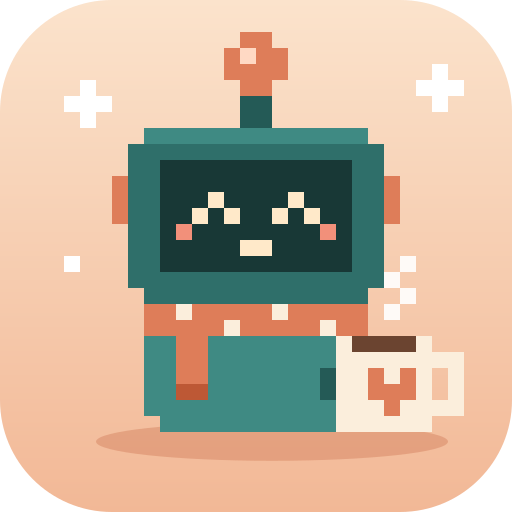

# Pixel AI Office



A cozy pixel-art office for the AI models behind your router. Claude, ChatGPT, DeepSeek, Gemini, Grok and any other model each get a chibi character and a desk. When your apps send a request through the router, that model's character sits down and writes it out, then walks over and hands the paperwork to you, the CEO, at the big desk. Idle agents doze off, and after a while they head out the door.

It works with OmniRoute and any other OpenAI-compatible router (LiteLLM, OpenRouter and so on), and it ships as a Claude Code plugin.

## What you get

- **A live office:** each model is a character with its own animations: writing, thinking, walking the aisles, queuing to hand in work, snoozing, leaving and coming back.
- **You as CEO:** a crowned chibi at the big desk, with a running count of tasks routed and handed in.
- **Five cozy themes:** Café, Snowy cabin, Sakura, Tea house and Starlight, each with its own furniture, windows and weather.
- **Six languages:** English, 简体中文, 日本語, 한국어, Español and Français.
- **Smooth navigation:** pinch or Ctrl+scroll to zoom where you point, drag or two-finger scroll to pan.
- **Team list:** who is working and who is resting, at a glance.
- **Your own art:** upload a PNG for any agent from the Sprites panel.
- **Retro UI:** switch the toolbar and panels to a full pixel look.

## Install the plugin

You need [Claude Code](https://claude.com/claude-code) and [Node.js](https://nodejs.org) 18 or later. There are no other dependencies.

1. In Claude Code, add this repository as a plugin marketplace:

   ```
   /plugin marketplace add tszlokmarcuslam/pixel-ai-office
   ```

   The repository is private, so Claude Code needs to be signed in to a GitHub account that can see it (the same way `git clone` would). If that isn't set up, clone it and add the folder instead: `/plugin marketplace add <path to the clone>`.

2. Install the plugin:

   ```
   /plugin install pixel-ai-office@agent-visualisation
   ```

3. Start the office, passing your router's address (OmniRoute's default is `http://localhost:20128`):

   ```
   /pixel-office http://localhost:20128
   ```

4. Open http://localhost:4317/office in your browser.

5. Point your apps at `http://localhost:4318/v1` instead of the router. Each call passes straight through, and the model that answers shows up in the office.

To look around without any traffic, open http://localhost:4317/office?demo=1.

## Run it without the plugin

Clone the repository:

```bash
git clone https://github.com/tszlokmarcuslam/pixel-ai-office.git
```

Then, from its folder, run these two commands, each in its own terminal:

```bash
node agentboard/server.mjs
```

```bash
ROUTER_URL=http://localhost:20128 node agentboard/router.mjs
```

Then open http://localhost:4317/office and point your apps at `http://localhost:4318/v1`.

## How it works

`agentboard/router.mjs` is a small pass-through that sits in front of your router. It forwards every request unchanged, streaming included, and writes one line per model call to `agentboard/events.jsonl`. `agentboard/server.mjs` streams those lines to the page, and `agentboard/office.html` draws the office.

Model names map to characters by name: `claude`, `gpt`/`openai`/`o3`, `deepseek`, `gemini`, `grok`/`xai`. Anything else gets a friendly robot labelled with its model family. If the router picks a different model than you asked for, as with OmniRoute's auto combos, the task goes to whichever model actually answers.

## Custom sprites

Drop a PNG named after an agent into `agentboard/sprites/` (for example `chatgpt.png`) and it replaces the built-in character. You can also upload a PNG per agent from the **Sprites** panel; uploads are saved in your browser.

## What's here

| Path | What it is |
|---|---|
| `agentboard/office.html` | The pixel office: characters, themes, languages, pathfinding and the toolbar. |
| `agentboard/router.mjs` | The router tap. Run `node agentboard/router.mjs --selftest` to check its model mapping. |
| `agentboard/server.mjs` | Serves the office and streams events to it. |
| `agentboard/sprites/` | Character art. |
| `.claude-plugin/`, `commands/` | The Claude Code plugin manifest, marketplace entry and `/pixel-office` command. |
| `plugin-icon.svg` | The plugin icon. |
| `agentboard/index.html`, `app/` | AgentBoard, the original team dashboard and its Mac app. See [agentboard/README.md](agentboard/README.md) and [app/README.md](app/README.md). |

## AgentBoard (the original dashboard)

This repo also contains AgentBoard: your Claude Code and Codex team (Team Lead, Product Manager, Designer and others) as a game-style office. Run `node agentboard/server.mjs` and open http://localhost:4317, or build the Mac app with `app/build.sh --install`. To change the team, edit `agentboard/team.json` and run `node agentboard/generate.mjs`.
